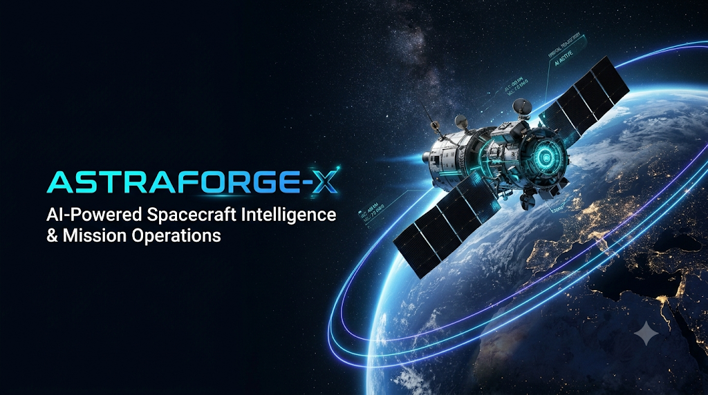
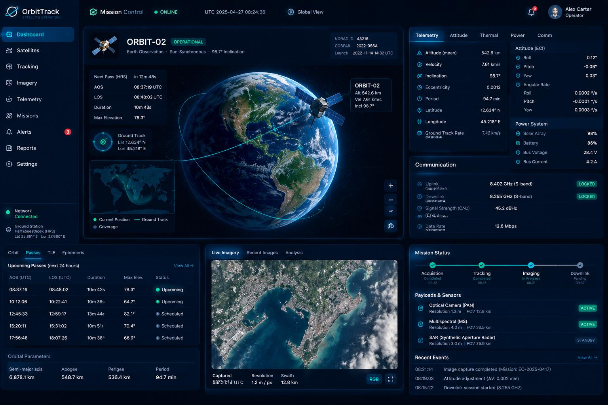
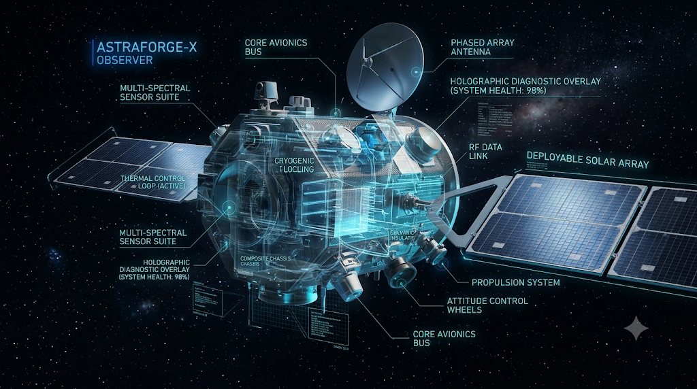
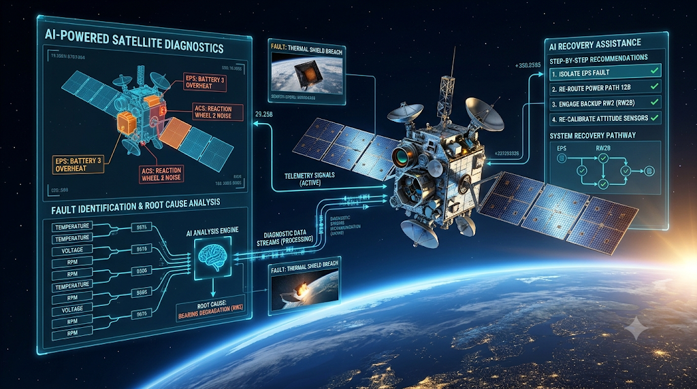
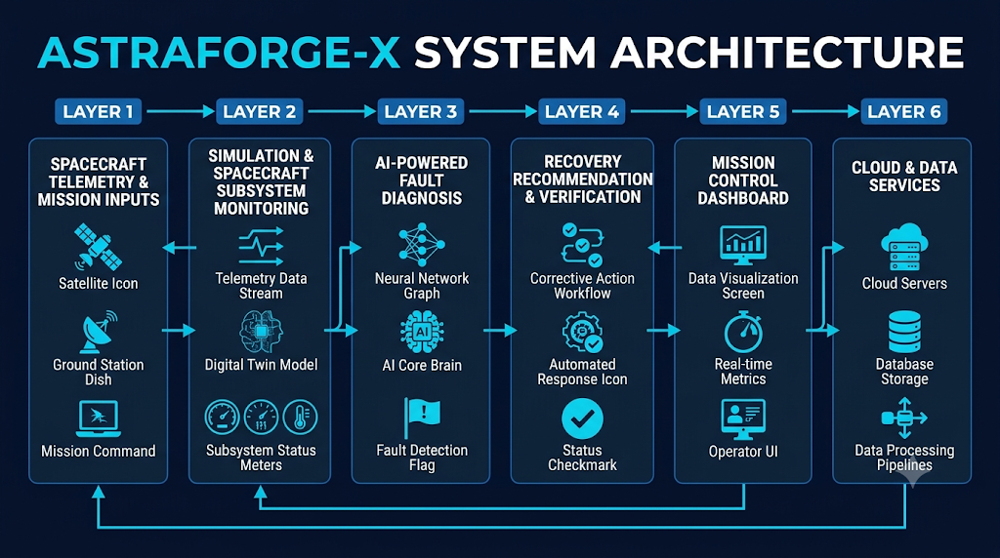
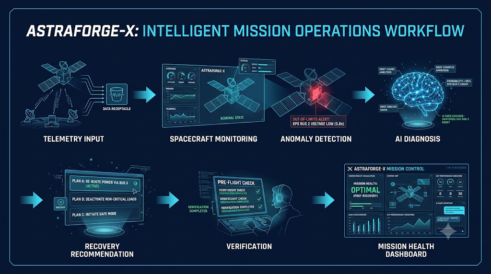
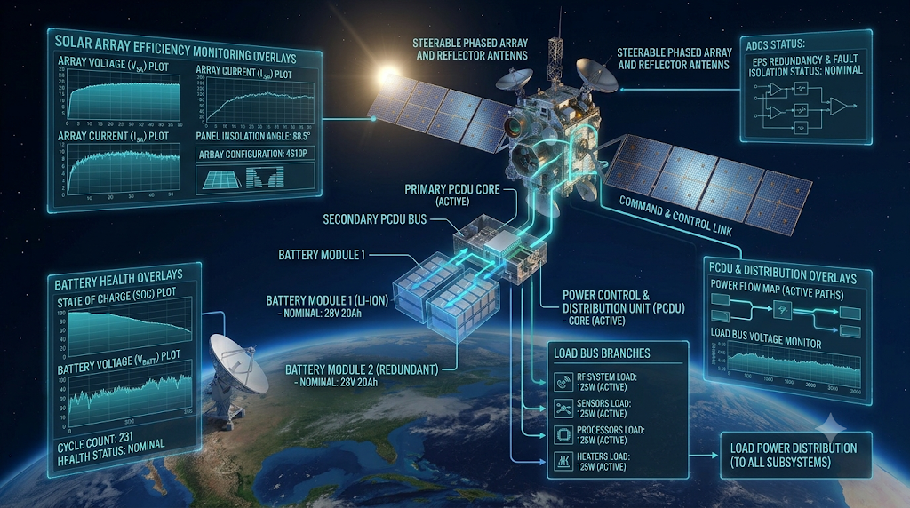
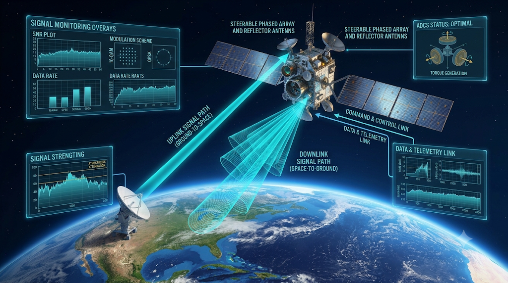
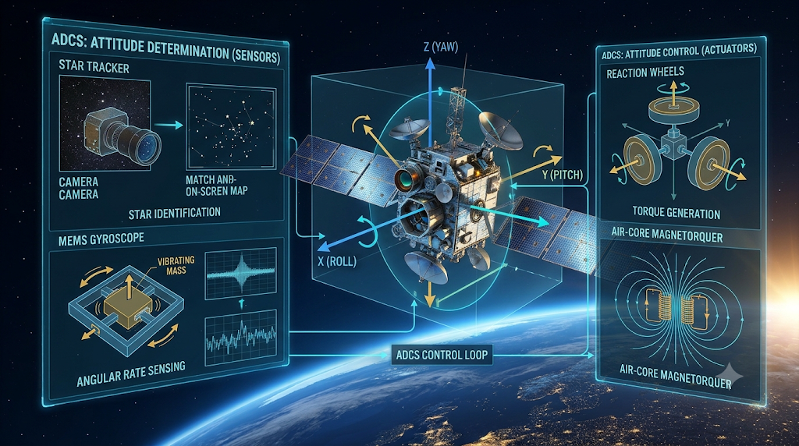
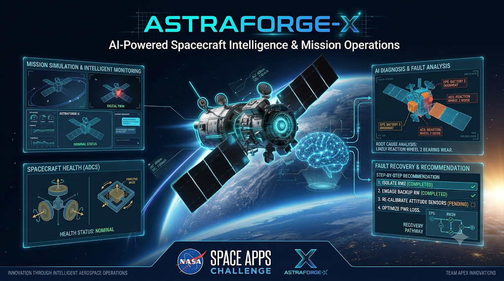

# 🚀 ASTRAFORGE-X
### Intelligent Spacecraft Digital Twin & Orbital Engineering Command Center

<p align="center">
  <strong>EXPLORE · SIMULATE · DIAGNOSE · RECOVER</strong>
</p>

<p align="center">
  
</p>

<p align="center">
  <a href="https://github.com/snehassneha4578-collab/ASTRAFORGE-X">
    
  </a>
  
  
  
  
</p>

---

# 📡 LIVE PROJECT DASHBOARD

<p align="center">
  <strong>ASTRAFORGE-X // MISSION STATUS OVERVIEW</strong>
</p>

| Dashboard Metric | Current Status |
|---|---|
| Project | ASTRAFORGE-X |
| Application | Spacecraft Digital Twin |
| Repository | Public |
| Development Branch | `master` |
| Framework | Next.js |
| Frontend | React + TypeScript |
| Simulation Mode | Interactive Simulation |
| Mission Environment | Spacecraft Engineering |
| Deployment | Not yet publicly deployed |
| Real Spacecraft Connection | Not connected |

### 🔗 Live Project Links

<p align="center">
  <a href="https://github.com/snehassneha4578-collab/ASTRAFORGE-X">
    
  </a>
</p>

> **Dashboard note:** This is a repository and project-status dashboard, not a live telemetry connection. The spacecraft values shown inside ASTRAFORGE-X are generated by the application's simulation.

---

# 🌌 01. PROJECT OVERVIEW

**ASTRAFORGE-X** is an interactive spacecraft engineering environment that combines a simulated digital twin, mission design, orbital environment modelling, subsystem telemetry, fault injection, AI-assisted diagnostics, and counterfactual what-if simulations.

Spacecraft are complex systems in which power, communication, onboard computation, thermal management, sensors, and attitude control work together.

A fault in one subsystem can propagate through multiple engineering networks and affect overall mission health.

ASTRAFORGE-X brings these relationships into one interactive command center, allowing users to explore spacecraft systems, simulate engineering conditions, investigate faults, and evaluate recovery scenarios.

---

# 🛰️ 02. LIVE ENGINEERING MODULES

| Module | Capability |
|---|---|
| 🌍 Space Universe | Explore celestial objects and space environments |
| 🎯 Mission Control | Execute, pause, and reset simulations |
| 🛠️ Mission Designer | Configure spacecraft mission parameters |
| ☀️ Space Environment | Explore simulated space-weather conditions |
| 🛰️ Digital Twin | Inspect spacecraft subsystems |
| 📊 Engineering Lab | Monitor simulated telemetry |
| 🤖 Problem Solver | Investigate spacecraft fault scenarios |
| 🔮 What-If Engine | Compare alternative engineering futures |

---

# ✨ 03. CORE FEATURES

## 🌍 Space Universe Explorer

Explore the solar system and deep-space environment through interactive celestial-object categories.

- Planets
- Moons
- Asteroids
- Comets
- Space debris
- Orbital environments
- Deep space
- Space weather

## 🎯 Mission Control

The central mission execution interface provides:

- Execute simulation
- Pause simulation
- Reset simulation
- Run mission
- AI-assisted diagnosis
- What-if simulation
- Safe reset

## 🛠️ Mission Designer

Build a simulated spacecraft mission by selecting:

- Mission objective
- Orbit
- Launch vehicle
- Spacecraft bus
- Scientific payload
- Solar array
- Battery
- Communication system

Evaluate estimated mission parameters:

| Parameter | Description |
|---|---|
| Budget | Estimated mission budget |
| Mass | Spacecraft mass |
| Power | Available power performance |
| Communications | Communication health |
| Risk | Estimated mission risk |
| Science | Science performance |
| Mission Success | Model-generated success estimate |

## ☀️ Space Weather & Orbital Environment

Explore environmental scenarios:

- Normal environment
- High solar activity
- Radiation burst
- Solar storm
- Magnetic disturbance

Understand the simulated causal chain:

```text
SOLAR EVENT
     ↓
RADIATION INCREASE
     ↓
SENSOR NOISE INCREASE
     ↓
MEMORY ERROR RISK
     ↓
COMMUNICATION DEGRADATION
     ↓
MISSION RISK INCREASE
```

Explore orbital categories:

- LEO — Low Earth Orbit
- MEO — Medium Earth Orbit
- GEO — Geostationary Earth Orbit
- Polar Orbit
- SSO — Sun-Synchronous Orbit

## 🛰️ Interactive Spacecraft Digital Twin

Inspect the spacecraft's engineering subsystems through an interactive visual interface.

| Subsystem | Function |
|---|---|
| PWR — Solar Array | Electrical power generation |
| BAT — Battery | Energy storage |
| CPU — Flight Computer | Onboard computation |
| BUS — Power Bus | Electrical distribution |
| RF — RF Transceiver | Radio communication |
| ANT — Antenna | Communication interface |
| THM — Radiator | Thermal management |
| SNS — Sensor Array | Mission and environmental sensing |
| ADCS — Reaction Wheels | Attitude control |
| PROP — Thrusters | Propulsion |
| RAM — Memory | Data storage |
| FPGA — Logic | Programmable logic |

Select components to inspect their simulated engineering states and available controls.

## 📊 Live Engineering Laboratory

Monitor simulated spacecraft telemetry:

- Solar power generation
- CPU load
- RF load
- Sensor load
- Generated power
- Total electrical load
- Bus voltage
- Battery percentage
- Power margin
- Thermal conditions
- Communication health
- Mission health

The digital twin models relationships between engineering subsystems to demonstrate how a change can influence downstream system behaviour.

## 🤖 Spacecraft Problem Solver

Explore simulated fault scenarios:

| Fault Scenario | Engineering Area |
|---|---|
| Battery Failure | Energy storage |
| Solar Array Degradation | Power generation |
| CPU Overload | Flight computer |
| Communications Failure | RF subsystem |
| Radiation Event | Space environment |
| Thermal Overload | Thermal management |
| Power Bus Anomaly | Electrical distribution |
| ADCS Anomaly | Attitude control |

The engineering recovery workflow follows:

```text
FAULT DETECTION
      ↓
CAUSAL DIAGNOSIS
      ↓
SOLUTION GENERATION
      ↓
RECOVERY EXECUTION
      ↓
MISSION VERIFICATION
```

## 🔮 Counterfactual What-If Simulation

Evaluate alternative engineering conditions without modifying the live spacecraft state.

Available scenarios:

- Battery reserve reduced by 20%
- Solar generation reduced by 20%
- CPU load increased by 25%
- Communication degradation
- Solar storm

Compare live and simulated future values for:

- Mission health
- Power
- Battery
- Communication
- Temperature

---

# 🏗️ 04. SYSTEM ARCHITECTURE

```text
              ASTRAFORGE-X
                    |
                    v
            MISSION DESIGNER
                    |
                    v
          SPACE ENVIRONMENT MODEL
                    |
                    v
         SPACECRAFT DIGITAL TWIN
                    |
          +---------+---------+
          |         |         |
          v         v         v
        POWER     AVIONICS    RF
          |         |         |
          +---------+---------+
                    |
                    v
             THERMAL SYSTEM
                    |
                    v
            SIMULATED TELEMETRY
                    |
                    v
          FAULT DETECTION ENGINE
                    |
                    v
          AI-ASSISTED DIAGNOSTICS
                    |
                    v
            RECOVERY SIMULATION
                    |
                    v
           MISSION HEALTH ANALYSIS
```

---

# 🧰 05. TECHNOLOGY STACK

| Technology | Purpose |
|---|---|
| Next.js | Application framework |
| React | Component-based user interface |
| TypeScript | Application logic and type safety |
| Tailwind CSS | Interface styling |
| Node.js | JavaScript runtime |
| npm | Package management |
| Git | Version control |
| GitHub | Source code hosting |

---

# 💻 06. INSTALLATION & EXECUTION

### Prerequisites

- Node.js
- npm
- Git

### Step 1 — Clone Repository

```bash
git clone https://github.com/snehassneha4578-collab/ASTRAFORGE-X.git
```

### Step 2 — Open Project

```bash
cd ASTRAFORGE-X
```

### Step 3 — Install Dependencies

```bash
npm install
```

### Step 4 — Start Development Server

```bash
npm run dev
```

### Step 5 — Open Application

Visit:

```text
http://localhost:3000
```

### Step 6 — Production Build

```bash
npm run build
```

---

# 📸 07. PROJECT SCREENSHOTS

### ASTRAFORGE-X — Main Interface


### Mission Control



### Spacecraft Digital Twin



### AI-Assisted Diagnostics



### System Architecture



### Engineering Workflow



### Power System



### Communication System



### ADCS Subsystem



### Competition Poster



---

# 🎯 08. PROJECT OBJECTIVES

1. Demonstrate interconnected spacecraft engineering systems.
2. Provide an interactive mission configuration environment.
3. Explore the influence of simulated space-weather conditions on spacecraft health.
4. Demonstrate fault propagation across spacecraft subsystems.
5. Explore engineering diagnosis and recovery workflows.
6. Compare alternative mission conditions through counterfactual simulation.
7. Make spacecraft engineering concepts accessible through an interactive digital twin.

---

# 🔬 09. ENGINEERING SCOPE & LIMITATIONS

ASTRAFORGE-X is an educational and engineering exploration prototype.

- Spacecraft telemetry is simulated.
- Mission success and performance values are model-generated estimates.
- Fault diagnosis and recovery recommendations are intended for demonstration and exploration.
- The application is not connected to a real spacecraft or satellite.
- No real flight-control commands are transmitted.
- Recovery recommendations are not validated flight procedures.
- Static visual indicators should not be interpreted as verified live hardware telemetry.

---

# 🚀 10. FUTURE SCOPE

Potential future enhancements include:

- Integration of real space-weather datasets.
- More detailed orbital mechanics and trajectory modelling.
- Advanced spacecraft power and thermal simulations.
- Enhanced fault-propagation models.
- Improved AI-assisted engineering diagnostics.
- Historical telemetry visualization.
- Cloud-connected simulation services.
- Extended mission planning and analysis tools.

---

# 🌠 11. PROJECT INFORMATION

| Field | Details |
|---|---|
| Project Name | ASTRAFORGE-X |
| Category | Space Technology / Digital Twin |
| Project Type | Interactive Software Prototype |
| Application Domain | Spacecraft Engineering |
| Framework | Next.js |
| Language | TypeScript |
| Challenge | NASA Space Apps Challenge |
| Repository | [GitHub — ASTRAFORGE-X](https://github.com/snehassneha4578-collab/ASTRAFORGE-X) |

---

<p align="center">
  <strong>ASTRAFORGE-X</strong>
</p>

<p align="center">
  <em>Explore the spacecraft. Understand the systems. Engineer the mission.</em>
</p>

<p align="center">
  🌌 BUILT FOR THE FUTURE OF SPACE ENGINEERING 🌌
</p>
